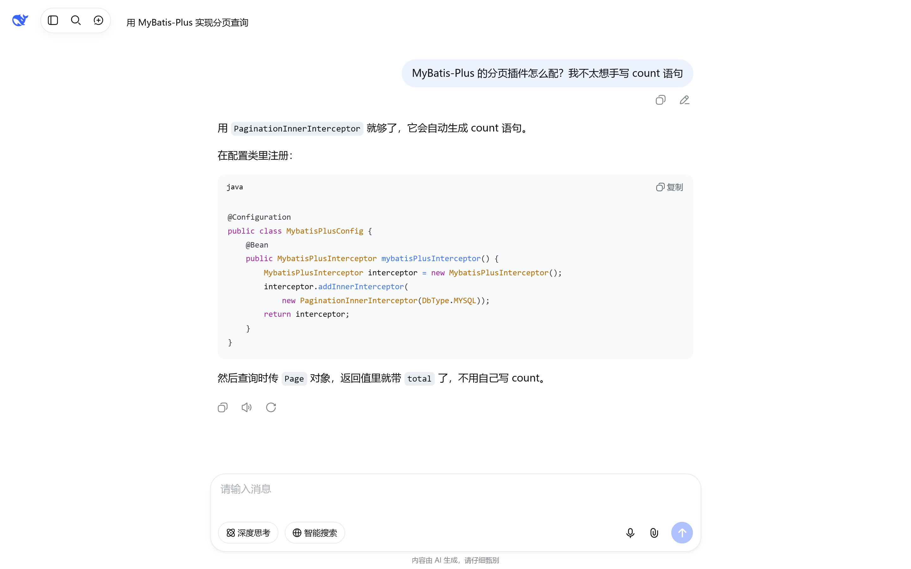
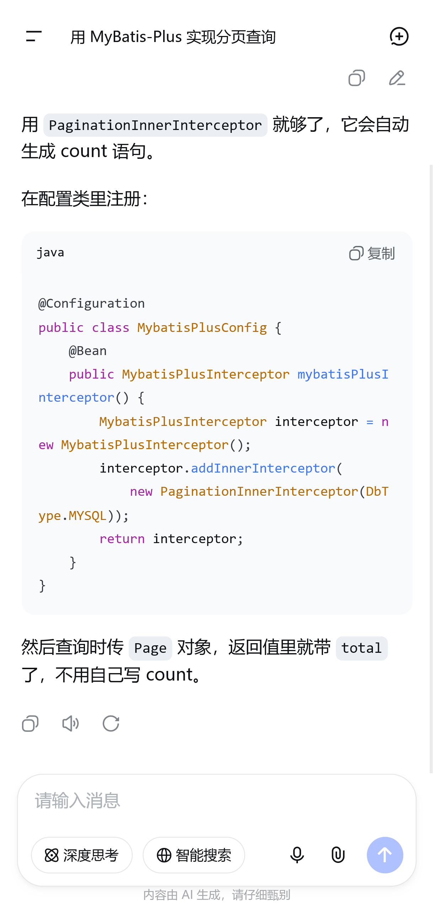

# chat-demo-cloud

把 [DeepSeek 官方开源的 chat-demo](https://github.com/deepseek-ai/chat-demo) 从「纯前端、数据存在浏览器里」
改造成「**数据存在服务器上、多设备共用同一份对话**」的自托管方案。

官方前端很完整，但 README 里写死了 `No application backend is required`——会话和附件存在
浏览器 IndexedDB，换台设备就什么都没有。这个项目补上了缺的那一层。

```
frontend/   DeepSeek 官方 chat-demo 的改造版（保留原界面）
server/     Spring Boot + MySQL 会话/附件/检索服务
android/    WebView 壳，打包成 APK
deploy/     docker compose + nginx 配置模板
```

---

## 效果

| 桌面 | 手机 |
|---|---|
|  |  |

界面就是官方那份：侧栏分组、消息操作、代码高亮、深度思考与智能搜索开关都在。
右侧悬停才展开的消息导航条也是按官方产物里的精确数值实现的。

---


## 做了什么

### 后端（新增）

会话和附件从 IndexedDB 搬到 MySQL + 磁盘，前端只做展示。

| 接口 | 说明 |
|---|---|
| `GET /api/sessions` | 会话列表（只返回摘要，不带正文） |
| `GET /api/sessions/{id}` | 单个会话完整 JSON |
| `PUT /api/sessions/{id}` | 保存会话，同时重建检索投影 |
| `PATCH /api/sessions/{id}` | 只改标题 |
| `DELETE /api/sessions/{id}` | 删除 |
| `POST /api/files?id=` | 上传附件 |
| `GET /api/files/{id}` | 下载附件（带 immutable 缓存头） |
| `POST /api/search` | 全文检索，返回高亮片段 |
| `POST /api/search/reindex` | 按 `sessions` 全表重建检索投影 |
| `GET /api/ping` | 健康检查 |

### 会话文档不建模

`doc` 列存前端 `Session` 对象的**完整 JSON 原文**，后端不解析、不建模。
只有 `title / created_at / updated_at` 是冗余出来的列，供列表查询和排序。

好处：

- 前端加字段不用后端发版
- 不会出现「Java 侧模型」和「TS 侧模型」两套真相
- 官方导出的 ZIP 可以原样复用

代价：后端无法按字段查询会话内容——这一需求交给下面的检索投影解决。

### 全文检索

`messages` 表是从 `doc` 派生的**投影**，只为搜索存在，随时可以整表删掉重建。

```sql
CREATE TABLE messages (
  session_id  VARCHAR(64) NOT NULL,
  message_id  VARCHAR(64) NOT NULL,   -- 注意：这是会话内序号，不是全局 ID
  ...
  PRIMARY KEY (session_id, message_id),
  KEY idx_session_seq (session_id, seq),
  FULLTEXT KEY ft_text (text) WITH PARSER ngram
);
```

两个容易踩的点：

1. **必须用 ngram 分词器**。MySQL 默认按空格切词，中文会被当成一整串，搜不到。
2. **主键是 `(session_id, message_id)` 联合主键**。因为 `message_id` 是 DeepSeek API
   返回的会话内序号（每条消息都是 `1, 2, 3...`），跨会话必然重复——单列主键会直接
   违反唯一约束。

`seq` 是后端按数组位置重算的顺序号，用来排序和定位「第几条消息」；
`message_id` 不能当顺序用（API 里会出现跳号）。

### 界面按官方 App 对齐

不是靠截图估的。官方前端产物（CSS/JS）是公开的，里面有 CSS Module 的哈希类名映射表：

```js
{scrollNav:"_189b4a0", scrollNavItem:"_81e7b5e", indicatorLine:"fae5876e", ...}
```

拿到类名就能从 CSS 里把精确数值挖出来，比如右侧消息导航条：

| 项 | 值（来自官方产物） |
|---|---|
| 容器 | 34×300，右侧 16px，垂直居中 |
| 背景 | 34 宽毛玻璃胶囊，`blur(5px)` |
| 行高 | 30px |
| 横线 | 8×2，当前项 `scale(1.5)` 并变蓝 |
| 悬停面板 | 240px 宽，`shadow-lv3` |
| 内边距 | `15px 0 15px 24px`（上右下左） |

最后那行尤其值得一提：它不在 CSS 文件里，而是运行时注入的
`--scroll-nav-page-padding`。只查 CSS 会漏掉，必须一并翻 JS。

移动端字号同理，量出来官方正文行距约 26px、侧栏标题 15px，逐个对齐。

### 其他

- **导入导出**：兼容官方 `export_format_version: 3` 的 ZIP，两边可以互导
- **图片选择器**：移动端点回形针弹「从相册选择 / 选择文件」，相册走 Android 13+
  系统 Photo Picker（自带网格、多选、零权限），桌面端保持点一下直接选文件
- **移动端交互**：侧栏推挤式抽屉 + 遮罩、任意位置右滑唤出、返回键关闭浮层
- **WebView 壳**：接管返回键、系统栏颜色跟随页面主题、文件选择器

---

## 快速开始

```bash
# 后端
cd server && mvn -DskipTests package
cd ../deploy && cp ../.env.example ../.env   # 填密码和 token
docker compose up -d

# 前端
cd ../frontend && pnpm install && pnpm build
# 把 dist/ 交给 nginx，并把 deploy/nginx-chat-demo.conf.example 加进站点配置
```

完整步骤见 [deploy/README.md](./deploy/README.md)。

---

## 安全模型

**DeepSeek API Key 只存在浏览器 localStorage，由浏览器直连 `api.deepseek.com`，
从不经过本项目后端。**

后端接口用一个固定口令保护，由 nginx 注入请求头：

```nginx
location ^~ /api {
    proxy_pass http://127.0.0.1:8080;
    proxy_set_header X-Auth-Token "你的口令";   # 客户端看不到，也无法伪造
}
```

如果把口令打包进前端会把密钥公开（任何人都能从 JS 里读出来），所以默认
`STORAGE_TOKEN` 为空，生产环境交给反代。

⚠️ **这个口令不是登录系统。** 所有访问者共享同一份数据，没有账号隔离。
要限制访问请在 nginx 层加 `auth_basic`、IP 白名单或绑到内网。

---

## 与官方 chat-demo 的差异

| | 官方 | 本项目 |
|---|---|---|
| 会话存储 | IndexedDB | MySQL |
| 附件存储 | IndexedDB | 服务器磁盘 |
| 多设备同步 | ❌ | ✅ |
| 全文检索 | 无 | 中文 ngram + 高亮片段 |
| 后端依赖 | 无 | Spring Boot + MySQL |
| API Key | 浏览器持有 | 浏览器持有（相同） |
| 界面 | 官方原版 | 官方原版 + 移动端细节对齐 |

---

## 技术栈

| 部分 | 技术 |
|---|---|
| 前端 | React 18 + TypeScript + zustand + rspack 2 |
| 后端 | JDK 21 + Spring Boot 3.5 + MyBatis-Plus 3.5 |
| 数据库 | MySQL 8（中文检索依赖内置 ngram 分词器） |
| 安卓 | 原生 WebView 壳，手工打包（`aapt2` + `d8` + `apksigner`，无需 Gradle） |

---

## 许可与声明

- `frontend/` 派生自 [deepseek-ai/chat-demo](https://github.com/deepseek-ai/chat-demo)，
  沿用其 MIT 许可，详见 [LICENSE](./LICENSE) 与 [frontend/README.md](./frontend/README.md)
- `server/`、`android/`、`deploy/` 为本项目新增，MIT 许可
- **界面设计、DeepSeek 名称与鲸鱼标志的版权归 DeepSeek 所有**。
  本项目仅用于个人自托管学习，与 DeepSeek 官方无关联，不代表官方立场。

使用本项目需要自备 [DeepSeek API Key](https://platform.deepseek.com/)，按 token 计费。